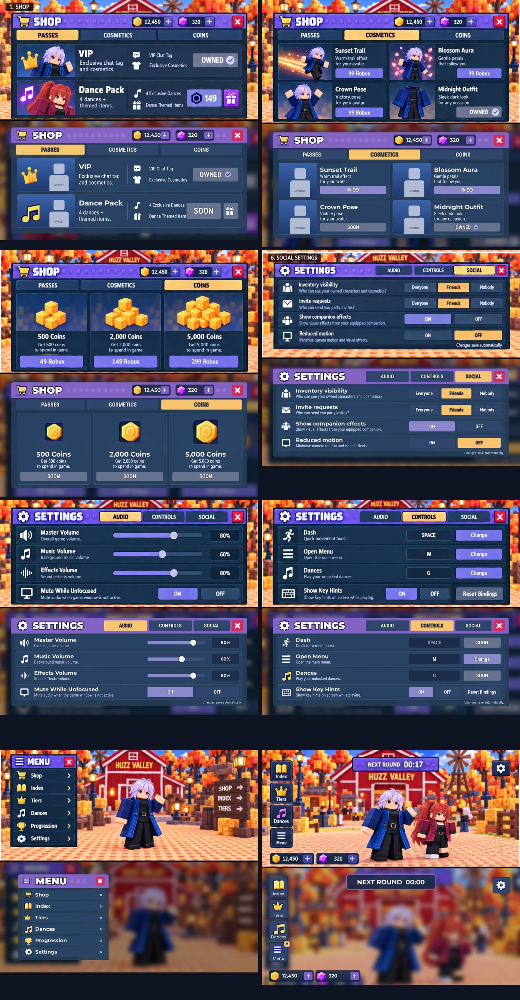

# Huzz Valley

The UI for Huzz Valley, built from your Huzz-Valley-UI-V2 kit (kept in `design/`). This first build is the "golden slice":
- the **Lobby HUD**;
- the **Main Menu**;
- the **Shop**, with its Passes, Cosmetics and Coins tabs;
- **Settings**, with its Audio, Controls and Social tabs;
- the **Character Index**, **Tiers**, **Dances** and **Progression** (Rewards and Quests) pages ([pictures](docs/previews/new-pages.jpg)).

All of these work against a real save system. When you're happy with how they look in Studio, the same parts get used to build the other pages.

## The game: Huss Valley's loop, with the anime girls
1. **Between games** (about 30 seconds, time to visit the shop) everyone votes for one of two maps. After you
   vote, the vote tucks into a small **NEXT MAP** panel at the top left (the arrow opens it again). The winner **replaces the map in front of the lobby**
   (the last one stays there until then). Then a **small roller at the top of the screen** runs from top to
   bottom and stops on the game's girl. She then floats **big over the map** for the whole game, turning slowly
   in a column of light with sparkles and her rating (stars, name, rarity) over her head. Each roller row shows
   the girl's real model, her name, her rarity and that
   rarity's real chance. Every row is a fair pick (Common → Secret, from `Config/Round.Rarities`).
2. Everyone is moved onto the map ([how Huss Valley does it](docs/previews/hv-reference-1.jpg)). One random player is the **catcher**, in the
   middle with a **knife**; everyone else runs. The girl floats over the map. **Runners win by getting everyone
   across 3 rounds in a row**; catchers win by catching every runner.
3. **Every round starts with the line-up:** runners stand side by side on their safe line. The camera sweeps
   along them, a gold glow hops from runner to runner and lands on one at random, and zooms in
   ([video](docs/previews/intro-camera.mp4)). That runner picks **HERO** or **CHICKEN** on their screen (8
   seconds, or it picks for them). A **Hero crosses alone first** while everyone watches. Make it and the girl
   comes down onto your shoulders, plus 25 coins. **Chicken** means everyone runs together.
4. **RUN!** Catchers **stab** (click, or the STAB button on a phone). A stabbed runner **falls down** where they
   are. Stand next to a downed runner to **rescue** them (a bar fills over their head). Anyone still down at the
   end of the round **joins the catchers**, and the "in a row" count starts again. Once you're **safe across,
   you stay across**: an invisible gate on the goal line stops you walking back into the middle.
5. **The girl:** a catcher who stabs her carrier **steals her** (she follows him). The next Hero who makes it
   takes her back. When the game ends she goes home with the winning side, into their **Index**.
   - Controls in a round: **no mouse pointer** (shift lock); **hold Alt** to get the pointer back. **Space**
     is the **huss**: a sideways dash, left or right (A/D picks the side), and you can't jump. Hold **W** and you set off at a walk that builds
     into the full run over about a second ([video](docs/previews/moves-walk-run-dash.mp4)).
   - **G** opens the **dance wheel** anywhere: 8 see-through circles with your avatar mid-dance (favourites first),
     press a number or click; walk away to stop ([picture](docs/previews/dance-wheel-vs-reference.jpg)). Start the
     same dance next to someone who's doing it and you dance in step. All **25 dances** from your file are
     in the Dances window too, with your own avatar dancing in the preview.
   - The top of the screen is a small kit plate: ROUND 2 and the clock, your role, the "in a row" bars, and one
     line for what just happened ("Messi is safe") ([picture](docs/previews/round-hud.jpg)). The lobby buttons
     and coin pills slide away while you play.
   - Name tags over everyone show their role, level and wins. Outlines: catchers **red**, runners **blue**,
     the Hero **yellow**, safe runners **green**.
6. **Your anime girls:** equip one in the **Index** and a small her **walks behind you** in the lobby, glowing
   in her own colours. You get her aura too, growing with her rarity: just a few faint sparkles for Common, a
   soft glow for Rare, small hand flames for Epic, and the full flames, smoke and crescent slashes only from
   Legendary up ([video](docs/previews/girl-auras.mp4),
   [next to your reference](docs/previews/girl-auras-vs-reference.jpg)). In rounds she reacts to what you do.
   The girl over the map now wears her aura big, with nothing under her feet.
7. **Powers** (free, fresh every round; Q and E, or tap the cards at the bottom of the screen):
   - Runners: **Heart Shield** (a pink bubble that blocks one stab; the catcher gets dizzy and you get a burst
     of speed; once per round) and **Rizz Rush** (a speed burst with a pink trail).
   - Catchers: **Love Trap** (drop a heart trap; the first runner who steps on it is stuck for a moment) and
     **Charm Wave** (a ring of hearts that slows runners near you).
   - Tune them in `Shared/Config/Powers.lua` (times, speeds, sizes, cooldowns).

8. **Coins** buy looks in the Shop's **ITEMS** tab: trails, name colours and knife skins (catchers). You earn
   coins every game, more when your side wins. **Aura** (Huss Valley's gems) comes from wins and the reward track,
   and will open **crates** once you design them (`Shared/Config/Crates.lua` has a ready example; every crate shows
   its odds and a pity counter).
   Glowing **Aura stars** float around the lobby: walk up and press **E** to collect (+1, White +3, Rainbow +10).
9. **New players** get a short **How to Play** card the first time they join (also in the Menu)
   ([picture](docs/previews/welcome.jpg)).

**Animations:** your walk, run, idle, jump, fall and climb come from your movement pack, the dash move is built
from its Sprint, and the 25 dances from your dance file. In **Studio** they play straight away. For the live
game they must be published once (checklist step 9). The stab is still a scripted placeholder.

**Set up your maps:** in each map, make a folder named after the map (e.g. `Graveyard`) holding 3 parts named
`ZoneA`, `ZoneB` and `Middle`. They can be invisible (Transparency 1) and non-colliding. Every game picks one of
your maps at random (never the same one twice in a row) and announces it. Rounds alternate sides: A → B, then
B → A, and so on. A part named `Lobby` anywhere is where players wait between games. With no zones, the game
builds a sandy test field so you can try it right away.
**Girls:** put them in `ServerStorage → AnimeGirls → <rarity folder> → <girl model>`. Until then, 4 grey
stand-in rigs are used.
**Try it:** press **Play** for solo mode (cross, then cross back to win), or use **Test → Clients and Servers →
3 players** for real rounds.
**Tune it:** `Shared/Config/Round.lua` (timings, speeds, rarities), `Shared/Config/Carry.lua` (how she's held:
size, tilt, arms, bounce, sway, dangling limbs) and `Shared/Config/Animations.lua` (your Huss Valley
walk/run/idle IDs). The carry sits on top of any walk animation: she rides on the torso and only the arms
are posed, so new animations need no code changes.

## Easiest way to play YOUR game with everything in it
Download **`places/HuzzValley-yours.rbxl`**
(https://github.com/ATREonYT/ROBLOX/raw/HUZZ-VALLEY/huzz-valley/places/HuzzValley-yours.rbxl). It's your own place
(your maps, girls and lobby) with every script already inside, so it needs no Rojo. Open it in Studio, save it as
your working copy, and press Play. When you change your map or girls, save, copy it to `places/HUSSANIME.rbxl` and
push, and I'll rebuild this file.

## Quickest way: open the ready-made game file
`places/HuzzValley.rbxl` has all the scripts plus a simple grass baseplate. You don't need Rojo.
1. On your Mac, open it on GitHub (branch **HUZZ-VALLEY**, folder `huzz-valley/places`) and click **Download raw file**. Or pull in GitHub Desktop and find it in the folder.
2. Double-click it, or in Studio use **File → Open from File**. Press **Play**.
3. To make it your real Huzz Valley game, use **File → Publish to Roblox As** and pick your Huzz Valley place. Your current place is empty, so nothing gets lost.

## Editing the UI in Studio
The whole UI is in **StarterGui > HuzzUI** as normal parts you can click and change.
- The HUD (side buttons, coins, gear) shows straight away. Each window (Shop, Settings, Index, and so on) is hidden: tick its **Visible** box to see it while you edit, then untick it again.
- **What stays in the game:** changes to position, size, colours, fonts, images and corners.
- **What the scripts still set:** text and on/off states.
- **To see every icon and picture while editing (no Play needed), install the helper once:**
  1. In the Explorer, open **ServerStorage → HuzzStudioTools**.
  2. Right-click **ShowPictures**, choose **Save as Local Plugin...**, then press **Save**.
  3. Open the **Plugins** tab at the top of Studio. A **Huzz Valley** group with two buttons should be there.
  4. **Show Pictures** draws everything while you edit (it also runs by itself when the place opens). **Upload Pictures** uploads them to Roblox once, so they show everywhere for good; then save, and send me the text of ReplicatedStorage → Shared → Config → ImageIds.
  5. Open **View → Output**. The helper writes what it did on lines starting with **[Huzz]**. If pictures still don't show, send me a screenshot of that window.
- **What doesn't stay:** edits to items inside lists (shop items, character and dance cards, rewards and quests), because the game redraws them. Tell me what you want changed there.
- **Before you ask me for UI changes after editing in Studio,** send me your export (the usual `tools/export-for-claude.lua` steps). Each new game file I make starts from my copy, so your edits need to come to me first.
- **If you use Rojo:** connecting Rojo replaces StarterGui > HuzzUI with my copy, so save your edits and send them to me first.

## Getting it into Studio with Rojo (for live updates)
1. In GitHub Desktop, switch to the **HUZZ-VALLEY** branch and click **Pull**.
2. Follow [ROJO-SETUP.md](../ROJO-SETUP.md), running `rojo serve` from this `huzz-valley` folder.
3. Open your Huzz Valley place, then go to **Plugins → Rojo → Connect** and press **Play**.

**What to try:**
- Press **M**, or click **Menu**.
- Open the **Shop** and switch tabs.
- Open **Settings** with the gear and change things. The changes stay while you play in Studio. Studio uses test saves, so they reset when you press Stop.

## If the icons don't show in Play
In Studio: **Home → Game Settings → Security → turn on "Allow Mesh / Image APIs" → Save.** That lets the game draw
the icons itself. To make them work everywhere for good, upload them once (Plugins → Huzz Valley → Upload Pictures).

## Your checklist (things only you can do)
1. **Upload the pictures once, so they show everywhere, including StarterGui while you edit:**
   1. Open the place in Studio (not while playing) and open **View → Command Bar**.
   2. Paste all of `huzz-valley/tools/studio/upload-images.lua` into it, press Enter, and wait for **Done** in the Output window.
   3. Save, then send me the text of **ReplicatedStorage → Shared → Config → ImageIds**, so my next game file has them too.
   - New pictures can stay grey for a few minutes while Roblox checks them.
   - If it shows red errors, send me a screenshot.
2. **Create the Robux items** on the Creator Dashboard after you publish:
   1. **VIP** is a Game Pass (it gives the [VIP] chat tag).
   2. **Sunset Trail** and **Blossom Aura** are Developer Products.
   3. Put each ID into `src/ReplicatedStorage/Shared/Config/Products.lua` (`Id = ...`). Until then their buttons say the item isn't on sale and never open a purchase.
   4. Prices there are placeholders. Roblox's live price shows automatically once an ID is set.
3. **Send me your girls and map**, so I can check every girl in the carry (size, how her limbs hang, rarity names)
   before tuning. Either:
   - save the place (File → **Save to File As** → `HuzzValley-full.rbxl`) into `huzz-valley/places/` and push it
     with GitHub Desktop (under 100 MB); or
   - paste `huzz-valley/tools/studio/export-girls-and-map.lua` into the Command Bar and send me the text of each
     `ServerStorage → ClaudeExport → PartN`.
4. **Delete the Basket Ball Hoop models.** They hide a scam that pops up "Model corruption detected… paste this
   into the Command Bar". Never paste it: it gives a stranger control of your game.
5. **Name your girls** in `src/ReplicatedStorage/Shared/Config/GirlNames.lua` (their model names are the avatar
   owners' usernames, so the game shows "Common Girl 1" and so on until you do).
6. **Icons for the 4 powers:** the cards show emoji (💖 ⚡ 💘 💞) until you send 4 see-through PNGs (256 px or
   bigger) named heart-shield, rizz-rush, love-trap and charm-wave.
7. **Things that need assets before they can go on sale** show their price, but only say "coming soon" when tapped:
   - Dance Pack: its Game Pass ID (its 4 dances are in now: Swing Time, Bounce Bounce, Squat Kick, Toprock);
   - Crown Pose: a pose animation;
   - Midnight Outfit: the clothing;
   - coin packs: they turn on once coins can buy something.

8. **Upload the 24 new sound effects** (made for this game, in `huzz-valley/assets/sfx`; until then a few
   Roblox stand-in sounds play and the rest are silent):
   1. Studio → **Window → Asset Manager → Bulk Import**, and pick every file in `huzz-valley/assets/sfx`.
   2. In Asset Manager → **Audio**, select them all and drag them into **Workspace**.
   3. Paste `huzz-valley/tools/studio/collect-sound-ids.lua` into the Command Bar and send me the Output lines
      that start with `[HuzzSfx]`. Then delete the sounds you dragged in.
9. **Publish the animations** (needed for the live game: until then the dances say "coming soon" there and
   the walk/run stay Roblox's. Studio already plays them, best tested solo). Paste
   `huzz-valley/tools/studio/publish-animations.lua` into the Command Bar and send me the `[HuzzAnim]` lines. If it
   says some couldn't publish, right-click those in **ServerStorage → HuzzAnimations** → **Save to Roblox...**
   and send me their IDs. Publish them under the account (or group) that owns the game, or they won't play.
10. **Dance names:** most of the 25 dances are copies of other games' emotes, so they have our own names in
    `Shared/Config/Dances.lua` (Citrus Groove, Shock Shuffle...). Rename any you like. The movement pack's licence
    is in `design/anims/movement-pack.zip`; check it allows use in a published game.
11. **Aura icon:** done, your star is in (the HUD, the shop and the lobby stars).
12. **Your crates:** what's in each, its Aura price and the odds (copy the example in `Shared/Config/Crates.lua`,
    or tell me and I'll fill it in).

## What's honest about this build
- **Pictures and icons:** almost all are now your sharp files (`design/sharp` and `design/icons-hd`), used as drawn and only trimmed to fit their spots. Five small icons are still the soft kit crops: the filled favourite star, the quest clipboard (Progression's title), the white shirt in the shop, the small gift and the small music note. Your pictures have see-through backgrounds, so the cards show a blue backdrop behind them.
- **Product pictures** show your own avatar, because there are no companion models yet. The coin cards use the coin icon instead of the gold-cube stacks.
- **The in-round screen** uses the kit's panels with Huss Valley's font (Gotham) and green accent. It isn't from a kit
  page, since the kit has no Match HUD page.
- **The studded texture** is drawn by us (`tools/icons/make_stud_pattern.py`); it shows after the pictures are
  uploaded (checklist step 1), like the other icons.
- **Sounds** are ours, made from scratch; nobody has listened to them in the game yet. Tell me which ones to change.
- **The carry** has been checked offline (the pose maths and every round rule have tests), but not yet in Studio.
  Tell me how it feels.
- **Gifting** says "unavailable" until the Gift Picker is built.
- **The Social settings** save and are checked on the server, but nothing in the game shows inventories or sends invites yet.
- **The Controls tab:** Dash (Space) and Dances (G) work and say FIXED: those two keys can't be changed. The Open Menu key can be changed now.
- **The pictures above come from an offline preview, not Studio.** Fonts and layout are close; the Robux sign and the blur behind windows are approximate. Your look in Studio is the real test.
