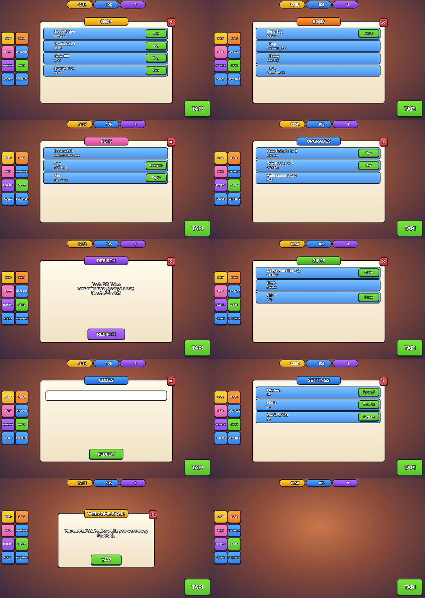

# New Game Kit

Every system a kid simulator needs, already wired, tested offline and built into a place file:
saving, cash, upgrades, rebirth, eggs with odds, pets, shop with passes and products, daily rewards,
playtime gifts, codes, leaderboards, settings and a cartoony HUD.
Start every new game from here, so the first day goes to **the game's idea**, not to plumbing.

## Honest status (October 30, 2026)
- **Runs offline:** 119 automatic checks (`tools/test.luau`) and a 60-check play-through (`tools/sim.luau`):
  two servers, purchases, rebirth, saving, offline earnings, Studio mode. All green.
- **Not yet run in Studio.** The offline Roblox is a stand-in (`tools/lune/RobloxMock.luau`). Do the Studio smoke test
  (step 4) before trusting it, and tell Claude anything red in Output.
- Icons are empty slots and product, pass and icon ids are 0: only the owner can upload and create them (repo rule).
- The HUD is a solid start in the toy style, not a finished look. Restyle it to the game's reference.

## Start a new game in 10 steps
1. **Copy the kit** (from the repo root): `sh new-game-kit/tools/new_game.sh my-game MyGame`.
   It renames the project and the save store and builds `my-game/places/MyGame.rbxl`.
2. **Pick the blueprint** for the game in `Build Playbooks/00 Build Router.md` (Egg Run, +1 Evolution, Speed Escape, Roll and Place RNG...).
3. **Edit one file: `src/Config/GameConfig.luau`.** Currencies, upgrades, eggs and odds, pets and boosts, shop, rebirth,
   daily track, gifts, quests. Codes go in `src/Config/GameSecrets.luau` (server only).
4. **Studio smoke test:** open the `.rbxl`, press Play. Check: coins tick up every second, TAP pays, every menu opens,
   an egg hatches, a pet equips, rebirth works, Output shows no red. In Studio saves reset on Stop on purpose
   (`studioResetsProgress`).
5. **Build the game's own loop** as a new service in `src/Server/` (same shape as `Upgrades.luau`: `Init(config)`,
   `PlayerData.RegisterSlice`, `Net.Handle` with a rate limit and one validator per argument). Pay players with
   `Currency.Earn`, so every multiplier applies. Wire it in `src/Main.server.luau`.
6. **Build the world** with the `roblox-cartoony-building` skill; the HUD with `roblox-cartoony-ui` (restyle `src/Shared/HudBuilder.luau`).
7. **Run the checks:** `PATH=/root/bin:$PATH sh tools/check.sh` (tests, play-through, then rebuilds the HUD and the place).
8. **Owner checklist before publishing:** create the Game Passes and Developer Products in the Creator Dashboard and put their
   ids in `GameConfig` (an id of 0 is never shown or sold); upload icons; turn on Studio Access to API Services once to test real saves.
9. **Launch** with `Build Playbooks/02 Launch and Discovery Cheat Sheet.md` (custom thumbnail, 16+ trial first, Friday or Saturday).
10. **Weekly update** on a fixed day: new egg, new upgrade tier, new codes.

Install Lune 0.10.5 once per session:
`mkdir -p /root/bin && cd /tmp && curl -sSLo lune.zip https://github.com/lune-org/lune/releases/download/v0.10.5/lune-0.10.5-linux-x86_64.zip && unzip -o lune.zip -d /root/bin && chmod +x /root/bin/lune && cd -`

## What the hits have, and where it is in the kit
Compared across our games (`cannon-evolution/`, `huzz-valley/`) and the October 2026 hits in
`Build Playbooks/01 Current Hits October 2026.md` and the five blueprints.

| Every hit has | In the kit | File |
|---|---|---|
| Saves that never lose progress, even with two servers | Session lock (90 s lease), save on leave and shutdown, schema migrations | `src/Server/PlayerData.luau` |
| Cash every second + a reason to come back tomorrow | Income per second, TAP, capped offline earnings with a welcome-back popup | `src/Server/Income.luau` |
| Upgrades with growing prices | Stat and multiplier upgrades, some reset on rebirth | `src/Server/Upgrades.luau` |
| Rebirth for a permanent boost | Geometric cost, bulk rebirth, `Rebirth.Rebirthed` signal | `src/Server/Rebirth.luau` |
| Eggs with rarity, luck and pity | Odds shown before every hatch, live while boosts run, pity counter | `src/Server/EggHatch.luau`, `src/Shared/Odds.luau` |
| Pets that boost you + an index | Equip boost on the main currency, discovery reward | `src/Server/Pets.luau`, `src/Server/Inventory.luau` |
| Shop: passes, products, a starter pack | Server-only grants, one `ProcessReceipt`, granted once per PurchaseId after the save | `src/Server/Shop.luau`, `src/Server/Receipts.luau` |
| Daily reward, playtime gifts, codes | Streak track, real-timer gifts, codes kept on the server | `DailyRewards.luau`, `PlaytimeGifts.luau`, `Codes.luau` |
| Quests that teach the loop | Quest chain fed only by server events | `src/Server/Quests.luau` |
| Leaderboards | All-time and weekly boards, budget-checked | `src/Server/Leaderboard.luau` |
| Settings for phones and comfort | Saved toggles (flashes, shake, music, hide others' pets, low graphics); the game's effects read `Setting_<key>` | `src/Server/Settings.luau` |
| Big readable numbers | 1.53K, 25.5M, 12T (never rounds up) | `src/Shared/Format.luau` |
| Level-ups every second (premium) | The grind split into 20 small levels per run, with a Level Up! [xN] streak; display only | `src/Shared/Progression.luau` (for a grind stat that isn't spent; the kit's coins are, so it's ready to use but not wired) |
| Every gain is felt (premium) | The Coins/Gems pill bumps and "+N" rises under it; fast gains are added together | `KitClient` TopBar section |
| Anime-style effects | Power-up aura with tiers and a charge-up, hits, craters, shockwaves, impact frames (kid-safe), speed lines, hit-stop, shake (picture: `previews/anime-aura.png`) | `src/Shared/AnimeFX.luau`, vault note 15 |
| Pacing proven before anyone plays | A bot plays the economy; first rebirth ~1.5 min, each run ~1.5x longer; fails if a beat misses | `tools/pace.luau`, `Config.Pacing` |
| HUD revealed by the tutorial (premium) | Only the bar at join; each step brings its button, spotlit; the rest pops in after the first rebirth | `Config.HudStages`, `src/Shared/HudStages.luau`, wired in `KitClient` (picture: `previews/hud-stages.png`) |

**Not in the kit (build per game, see the blueprint):** the core action (launching, running, rolling, stealing),
carrying and stealing between players, worlds and gates, trading, auto-roll, friend bonuses, group rewards,
music and sound assets.

## How it keeps the repo rules
| Rule (`CLAUDE.md`) | How |
|---|---|
| Never invent ids | Every product, pass and icon id is 0 or empty; id 0 items are hidden, never sold |
| Odds shown for paid random items | Eggs menu lists every outcome's chance before hatching; paid random products point to it and are hidden where `PolicyService` restricts them (fails closed) |
| No fake timers or scarcity | Gifts and daily use server time; no stock counters |
| At most 1 flash per second | The kit has no flashes; `Setting_Flashes` lets players turn effects off |
| Never sell what gives nothing yet | Id 0 products hidden; luck boosts refused at max luck (`Receipts.SetPromptCheck`) |
| Purchases granted only on the server, once, after the save | `PlayerData.ProcessPurchaseAsync`; the play-through checks a redelivered and a failed-save receipt |
| UI in StarterGui as real parts | `tools/build_place.luau` saves `src/StarterGui/KitHUD.rbxm`; the client reuses it |
| Rebuild the place after changes | `tools/check.sh` ends with the build |
| Toy UI, no emoji, no Gotham, no TextScaled, whole pixels | `src/Shared/HudBuilder.luau` (FredokaOne, lip, outline, gradient) |

## Folder map
- `src/Server/`: one ModuleScript per system (`ServerScriptService/Kit`). `src/Main.server.luau` wires them in order.
- `src/Shared/`: Net (remotes and validators), Odds, Format, HudBuilder, Signal, Janitor, RateLimit, Feedback, Progression, HudStages, AnimeFX (`ReplicatedStorage/Kit`).
- `src/Client/KitClient.client.luau`: the HUD's behaviour. `src/StarterGui/KitHUD.rbxm`: the HUD parts.
- `src/Config/`: `GameConfig` (display-safe) and `GameSecrets` (server only).
- `tests/`: specs. `tools/`: offline checks, play-through, place build, previews (`tools/preview/`), new-game script.
- `examples/`: small client examples per system from the original library.

## Credit
Most server modules are adapted from **LihFolk Systems** in `LihFolk/skills/lihfolk-systems/`
("LihFolk Vault V2", CC BY 4.0, https://creativecommons.org/licenses/by/4.0/). See `NOTICE.md`.
